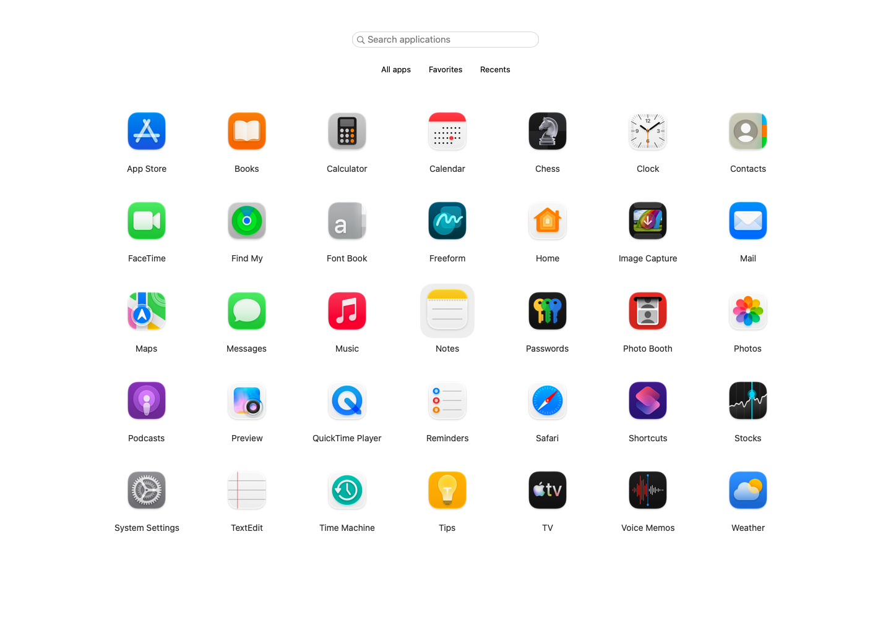

# Sofla

A familiar, full-screen home for your Mac apps. Built with SwiftUI and AppKit, light and fast.
No account, subscription, or analytics. Your app library stays on your Mac.



*The native interface with a curated set of macOS apps.*

**macOS 26+ · Apple silicon · Free and open source**

- Find apps instantly by typing, then press Return to open.
- Arrange apps into folders and keep favorites close.
- Choose a global shortcut and optionally open at login.
- Enable automatic updates or check manually from the Sofla menu.

Created by **Aleksei Iunes**.

## Install

[Download Sofla 1.0.0](https://github.com/a-yunes/sofla/releases/download/v1.0.0/Sofla-1.0.0-arm64.dmg).
Open the disk image, drag Sofla to Applications, and launch it. This release is not notarized
by Apple, so macOS may require Open Anyway in Privacy & Security. See [installation steps](INSTALL.md).
Setup includes a shortcut and optional Open at Login. Basic launching needs no privacy permissions.

## Build

Install Xcode 27 with Swift 6.4, then run:

```sh
./scripts/build-app.sh
open build/Sofla.app
```

This creates an ad-hoc signed build. Developer ID signing and notarization are optional for
a later release; the unnotarized release uses the first-launch approval described above.

## Contribute

See [CONTRIBUTING.md](CONTRIBUTING.md), [SECURITY.md](SECURITY.md), and
[RELEASING.md](RELEASING.md). The app uses SwiftUI, AppKit, and Sparkle for signed software updates.
Read [design.md](design.md) for the classic Launchpad experience and performance priorities.

Licensed under [MIT](LICENSE). Artwork is covered by [NOTICE.md](NOTICE.md).
